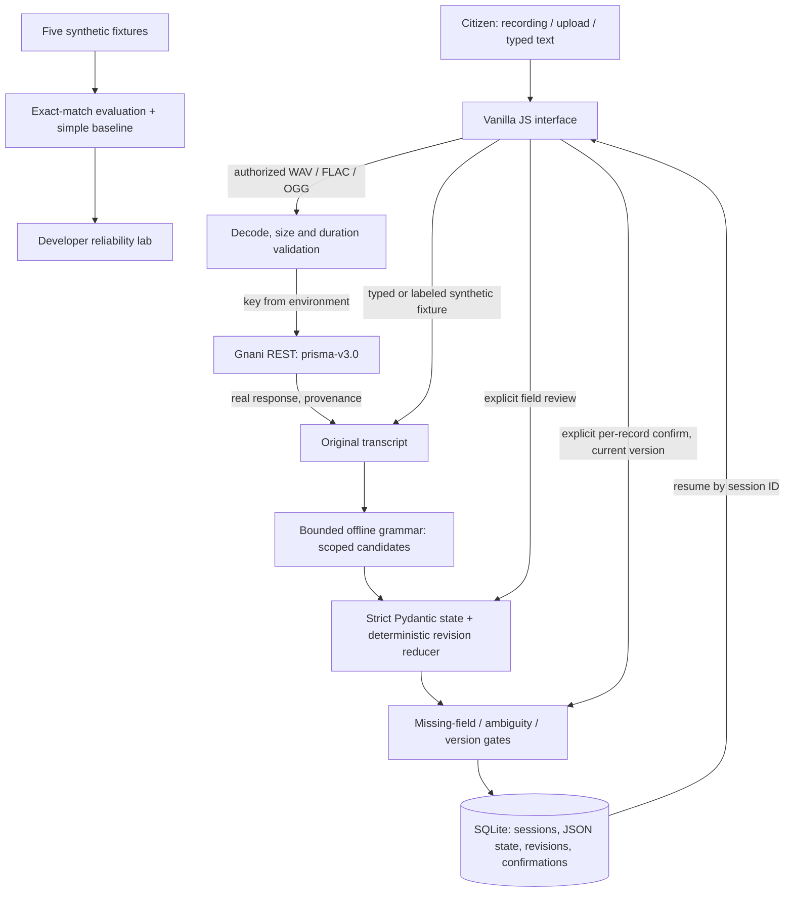

# BharatVoice

A working local Intent Integrity Engine for the Gnani AI Internship Challenge. Deadline: **November 10, 2026, 11:59 PM IST**. Python 3.11+, FastAPI, SQLite, strict Pydantic models, pytest, and a responsive vanilla JS interface.

Citizens describe civic problems, review separate complaint drafts, correct individual fields, and explicitly confirm complete records. No record is submitted to authorities. The application includes a real Gnani Prisma REST adapter, microphone recording, audio upload, resumable sessions, audit history, missing-field prompts, and a small reliability dashboard.

## Start exactly

Run from this directory. Python 3.11 or newer and a local microphone-capable browser are required for recording. Linux distributions without libsndfile may need their standard `libsndfile1` package for SoundFile; the installed Linux wheel worked in this environment.

```bash
python3 -m venv .venv
source .venv/bin/activate
python -m pip install -r requirements.txt
cp .env.example .env
python -m uvicorn app.main:app --host 127.0.0.1 --port 8000
```

Open **http://127.0.0.1:8000**. Interactive API docs: **http://127.0.0.1:8000/docs**. Health: **http://127.0.0.1:8000/api/health**.

For live STT, put your authorized Gnani key in `GNANI_API_KEY` in `.env` (or set the environment variable) and restart the app. Never commit `.env`. There is no fake-key fallback and no mock transcription in the running application. Without a key, typed input and clearly labeled synthetic fixtures work; valid audio uploads return HTTP 503 explaining that no live call was made.

Use localhost for microphone permissions (or HTTPS in a future approved hosting setup). Recording captures locally, stops at 29 seconds, encodes mono PCM WAV, and shows a playback control. Only clicking **Transcribe with Gnani** sends the recording. Check the authorization box first. Upload supports WAV, FLAC and OGG, with actual decoder validation, mono/stereo, 0.1–30 seconds, and a 10 MiB application limit. The upstream service also supports other formats; this MVP intentionally accepts a validated subset.

## One-minute walkthrough

1. Open **Try a synthetic demo scenario** and choose **Correction scope**. Two drafts appear. Every transcript is labeled `SYNTHETIC FIXTURE · NO API CALL`.
2. Inspect the records: drainage near School; water in Building, time Monday. Expand revision history to see evidence including “not Sunday”.
3. Correct one issue using **Apply clarification to**, or expand **Review or correct fields manually** for an arbitrary address. Saving fields preserves revisions and revokes confirmation.
4. Click **I confirm this record** on each complete issue. Incomplete records remain disabled, and server validation independently rejects them.
5. Copy the session ID, refresh, or paste it into Resume. SQLite retains transcripts, issues, revisions, versions and confirmations.
6. Inspect the reliability lab for expected/actual records and the baseline definition. No STT metric is implied.

See `DEMO_STORYBOARD.md` for the timed 60-second script and live-recording alternative.

## Gnani integration: documented, live execution pending

Documentation read on **2026-11-10**: <https://docs.gnani.ai/api/STT/speech-to-text> (also available as `.md`). A short contract reference is in `docs/GNANI_CONTRACT.md`.

The application sends multipart **POST https://api.vachana.ai/stt/v3** with:

- `X-API-Key-ID`: environment-supplied key; `X-API-Request-ID`: generated UUID.
- `audio_file`: validated file.
- `model=prisma-v3.0` (explicit; omitting this defaults upstream to v2.5).
- `language_code=kn-IN,en-IN` and `format=transliterate` (documented v3 output style, Latin letters throughout).

Romanized output serves the bounded offline parser; it is not a claim that transliteration preserves all dialects or corrections. Actual successful responses are labeled `ACTUAL GNANI API OUTPUT` and persist request ID/model with the original transcript. `detected_language_code` is not expected for `transliterate`. There is no confidence score. The adapter rejects malformed, truncated or unexpected-model responses; handles empty speech; bounds connection time to 5 seconds and request I/O to 25 seconds; and reports upstream authentication, rate-limit and service errors without exposing keys or response bodies. No automatic retries or hidden fallback are performed. Save conflicts return HTTP 409 rather than overwriting another turn.

**No credentials were available, and no live Gnani call was made.** HTTP contract/error tests use synthetic mocked responses and are explicitly named accordingly. Live Prisma usage is implemented in the upload/recording path, but the challenge requirement for a demonstrated genuine live call remains unverified until you configure a key and test authorized audio. `/api/health.live_verified` records this build's verification status, not credential validity.

## Extraction and integrity boundaries

No authorized LLM endpoint was configured. The offline fallback is a **bounded lexicon/grammar parser plus a state reducer**, not a general multilingual extractor. Its strict Pydantic Issue/Session/Revision models reject extra keys and coercion; deterministic gates own status and confirmation. There is no LLM-generated confirmation path.

Supported service words include water, streetlight/street light, drainage/drain, garbage/waste, and a small Kannada/Romanized lexicon (`neeru`, `beedi deepa`, `charandi`, `kasa` and selected native-script terms). Location grammar recognizes house numbers, Main Road, numbered Cross forms, and a bounded set of preposition-led places. Time references recognize named weekdays, yesterday/today and day durations. They remain literal references; the system does not invent dates. Time is optional; service category and location are required for this MVP. “School”/“Building” are extracted as stated, not geocoded or assumed sufficient for real dispatch.

Issue mentions define scopes. Corrections `not`, `actually`, `sorry`, `alla`, and `badalu` apply within that scope. A unique previously mentioned category can be corrected; multiple candidates require issue selection. Ambiguous corrections revoke confirmations and block possible targets. Conflicting confirmation language blocks records until explicit clarification; transcript text never grants consent. Multiple locations without a correction marker require clarification. New accepted field values revoke confirmation and append evidence to the revision log. Incomplete “the location is...” explicitly clears the location. Original utterances and original issue text remain intact.

**Limits:** This is regex/lexicon-assisted deterministic processing with synthetic coverage, not evidence of multilingual robustness. Arbitrary addresses, spelled-out house numbers, unfamiliar Kannada transliterations, implicit pronouns across many issues, unusual negation, and complex narratives can be missed or mis-scoped. Do not use the five scenarios as a language benchmark. Review all fields; use manual field review for unsupported values. An issue containing only a house correction has unknown service and cannot be confirmed until the service is supplied manually. The MVP has no free-form semantic problem validation, authority submission, calibrated confidence, accent fairness measurement, or production reliability claim.

## Architecture



SQLite stores a versioned JSON aggregate per session in a `sessions` table. Each write atomically compares the prior version, preventing lost updates; all issue records, turn provenance, revisions and confirmation events are inside that aggregate. Session and issue UUIDs remain stable. This small local design avoids migrations and multi-table transaction complexity. It is not a distributed queue or an append-only tamper-proof audit system. Session IDs act as resume capabilities; no authentication is provided. Keep the app bound to localhost. Audio bytes are not retained by this app; transcripts and metadata persist locally. Upstream retention is governed by your Gnani account terms.

## Tests and measured evaluation

```bash
source .venv/bin/activate
python -m pytest -q
python evaluate.py
# Optional: save a fresh machine-readable report
python evaluate.py > work/evaluation.json
```

Measured in this environment using **Python 3.12.14**: **52 passed, 0 failed**, with one upstream Starlette/httpx deprecation warning. Tests include five required synthetic fixtures plus multi-issue correction scope, repeated corrections, missing locations, unknown inputs, contradictory instructions, interruption/resume, optimistic concurrency, explicit confirmation/revocation, arbitrary manual addresses, schema strictness, audio validation, and mocked Gnani success/errors/timeouts. Versions used are recorded in `VALIDATION.md`.

The five hand-authored fixture cases produced **5/5 exact matches for the engine, 0/5 for the simple baseline**. Exact match compares the ordered list of category/location/time records. Baseline returns one record with the first category, first location and first time; it has no correction handling or session state. This is a deliberately weak, transparent comparison, with fixtures known during implementation. It is not a held-out study, does not measure STT, and is not an overall accuracy claim. `fixtures/scenarios.json` labels all examples synthetic.

Browser verification uses the running local app, not an API mock:

```bash
python -m pip install -r requirements-browser.txt
PLAYWRIGHT_BROWSERS_PATH=work/browsers python -m playwright install chromium
# In another terminal, keep uvicorn running as above
PLAYWRIGHT_BROWSERS_PATH=work/browsers python tests/browser_smoke.py
```

It checks two issues, missing-field confirmation blocking, one-issue clarification, explicit confirmation, reload continuity, manual field edits, and mobile width. Browser screenshots and the measured evaluation are included under `evidence/` in the deliverable archive. Browser install is optional for running the app.

## Main files

- `app/engine.py`: strict schema, bounded extraction, corrections, missing fields and state.
- `app/store.py`: SQLite aggregate persistence and optimistic write validation.
- `app/stt.py`: real documented Gnani adapter and decoded audio validation.
- `app/main.py`: FastAPI routes, explicit review gates, fixtures, static UI.
- `app/static/`: citizen page and reliability lab, no build step or external frontend dependencies.
- `app/evaluation.py`, `evaluate.py`, `fixtures/scenarios.json`: reproducible synthetic evaluation.
- `tests/`: automated synthetic unit/API tests and optional browser smoke script.
- `requirements.txt`, `pyproject.toml`, `.env.example`: setup and configuration.

## Exact remaining steps

1. Start locally with the commands above.
2. Configure an authorized Gnani key in `.env`, restart, record/upload an authorized 0.1–30-second WAV/FLAC/OGG, and click **Transcribe with Gnani**. Verify actual response/request ID and both English and Kannada-English correction preservation. This was not executable without a key.
3. Review every extracted value; use explicit manual fields where the bounded grammar does not recognize the address. Re-confirm after changes.
4. Demonstrate the five scenarios and persistence using the storyboard; include the honest integration status in the challenge submission.

Nothing has been deployed or published. Deployment requires your approval.
